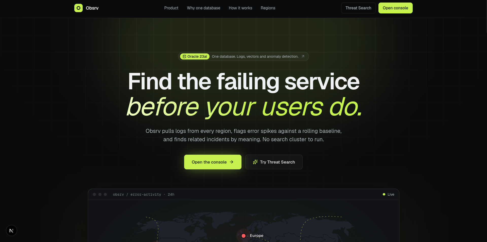
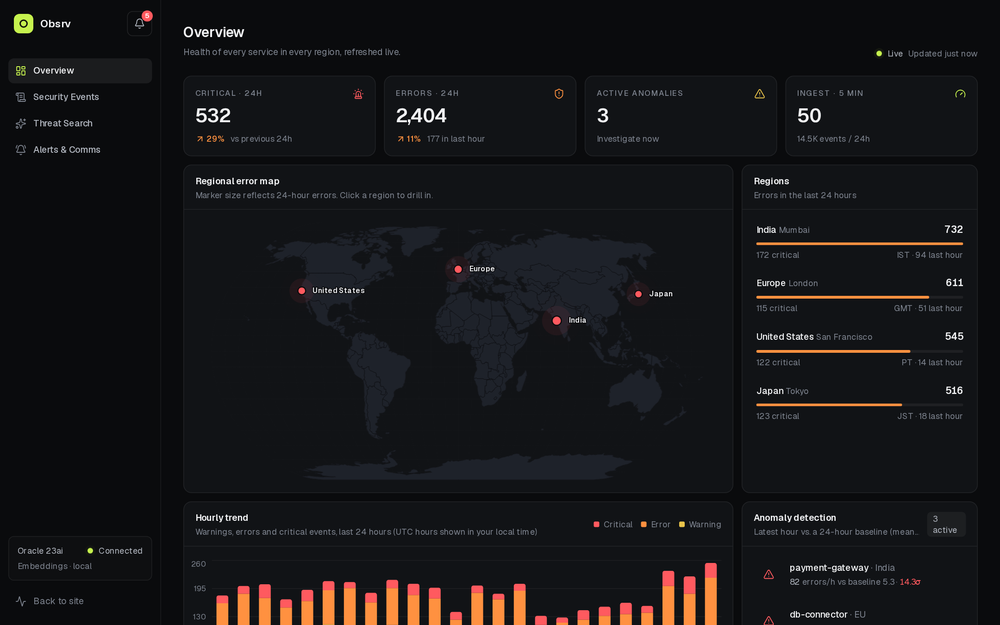
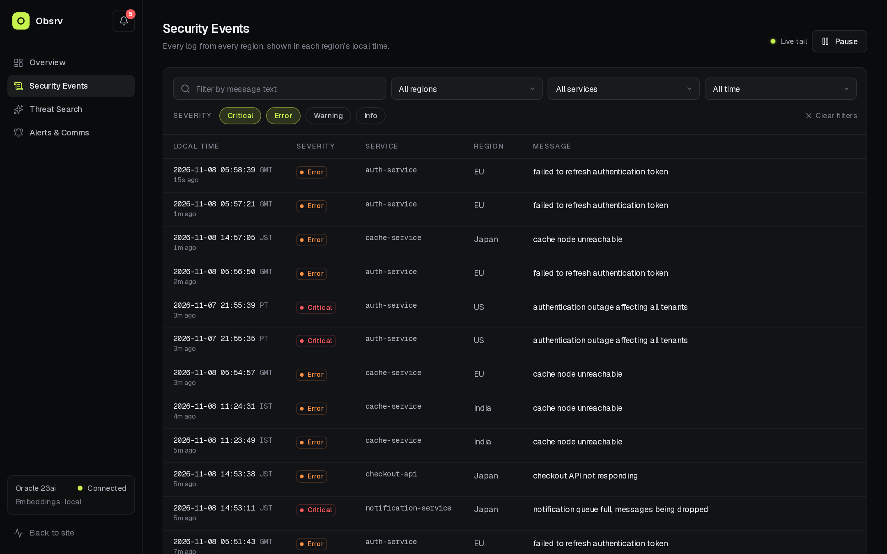
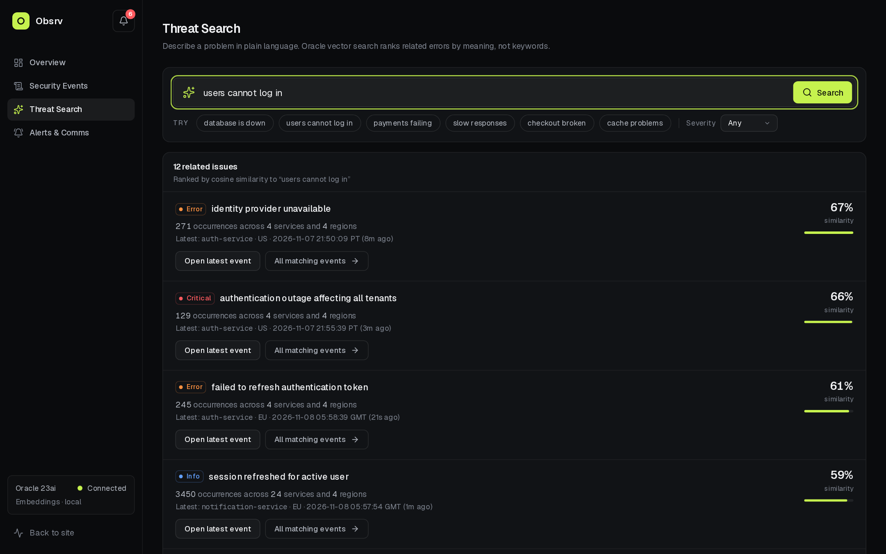
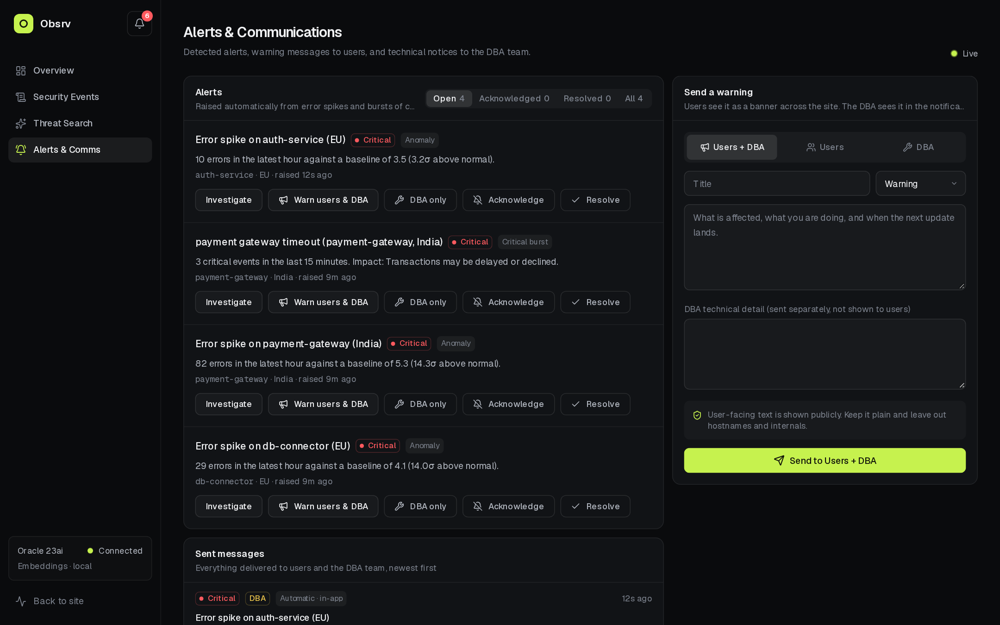
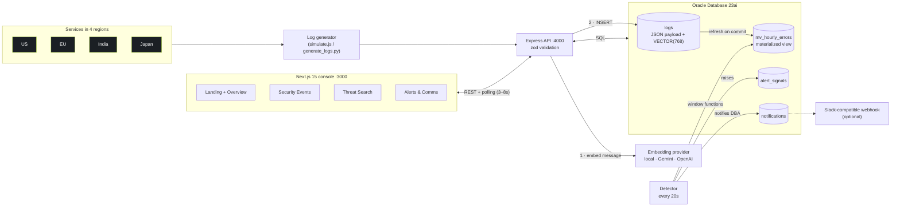
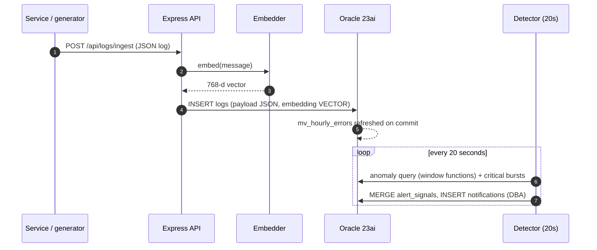
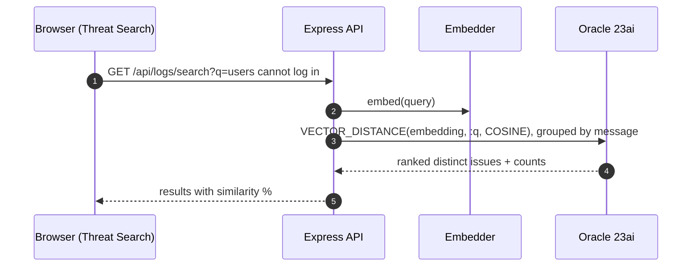
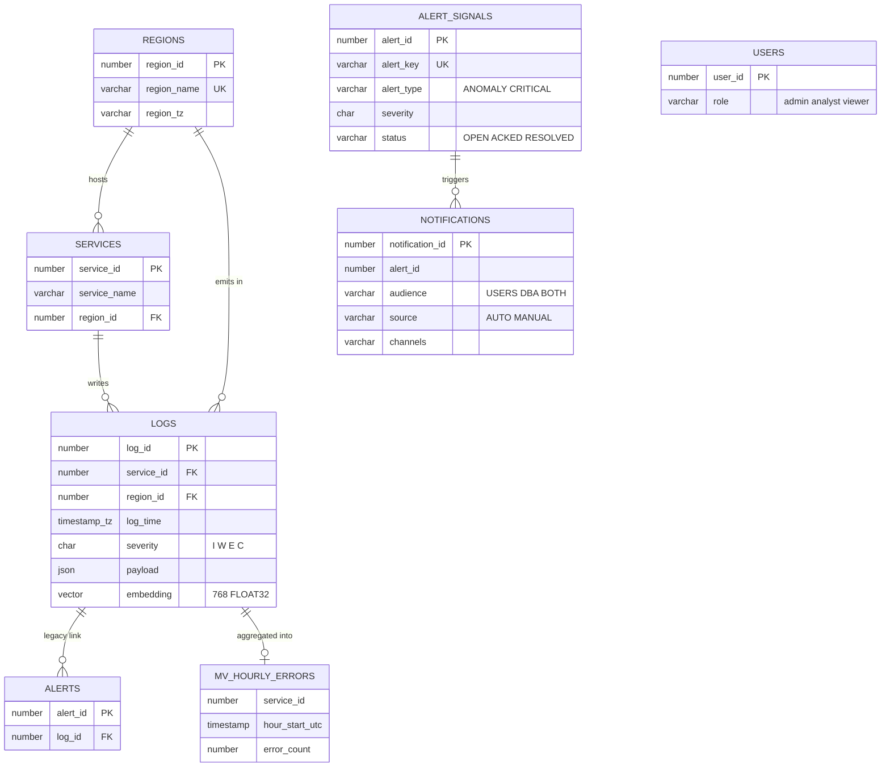

<div align="center">

# Obsrv

**AI-powered log observability on a single Oracle Database 23ai.**
Collect JSON logs from four regions, catch error spikes, find related incidents by meaning, and warn users and the DBA — with no search cluster to run.


</div>

## Live demo

<p align="center">
  
</p>

The landing page above is served by your own instance: the map, the counters and the event ticker are **live data** from the database (refreshing every few seconds). Run it locally in three commands — see [Quick start](#quick-start).

| Overview | Security Events |
| --- | --- |
|  |  |
| **Threat Search** | **Alerts & Communications** |
|  |  |

## What it does

- **Collects** JSON logs from services in four regions (US, EU, India, Japan) through one HTTP endpoint.
- **Stores** each log with a 768-dimension AI embedding in the same row — one database, no sync jobs.
- **Shows** errors, anomalies and trends on a live dashboard with a world map.
- **Finds** related issues *by meaning*: searching “users cannot log in” surfaces “identity provider unavailable”.
- **Alerts** automatically when a service drifts from its baseline, notifies the DBA, and lets you warn users with a banner across the site.

### Pages

| Route | Purpose |
| --- | --- |
| `/` | Landing page with live regional map, counters and event ticker |
| `/overview` | KPIs, error map, hourly trend, anomaly detection, live stream, service health |
| `/logs` | **Security Events** — filter by region, service, severity, time and text; live tail; event drawer with raw JSON and related events. Times are shown in each region’s local timezone |
| `/logs/[service]` | Per-service history and regional breakdown |
| `/search` | **Threat Search** — plain-language semantic search over Oracle vectors |
| `/incidents` | **Alerts & Comms** — auto-detected alerts, acknowledge/resolve, warnings to users / DBA / both, sent history |

## Architecture



### Request flows

**Ingest and detect**



**Semantic search**



## How the database does the work

Everything the stack would normally spread across Elasticsearch, Kibana and an ML service is handled in Oracle.

| Need | Oracle feature | Where |
| --- | --- | --- |
| Flexible log shape | Native **`JSON`** column queried with `JSON_VALUE` / `JSON_SERIALIZE` | `logs.payload` |
| Search by meaning | **`VECTOR(768, FLOAT32)`** + `VECTOR_DISTANCE(..., COSINE)` | `logs.embedding`, `/api/logs/search` |
| Fast hourly trends | **Materialized view**, `REFRESH FAST ON COMMIT` with a materialized view log | `mv_hourly_errors` |
| Anomaly detection | **Window functions**: `AVG`/`STDDEV_SAMP` over the previous 24 hours, `LAG` | `routes/dashboard.js` |
| Per-region local time | `TIMESTAMP WITH TIME ZONE` and `AT TIME ZONE region_tz` | every log query |
| Ranking | `RANK()` / `DENSE_RANK()` over regions and services | Overview summary |
| Access control | Roles `viewer`, `analyst`, `admin` with object grants | `schema.sql` |
| Alerts and messages | Plain relational tables with `CHECK` constraints | `alert_signals`, `notifications` |

**Anomaly rule** — a service is flagged when its latest-hour error count exceeds the mean plus three standard deviations of the previous 24 hours (and is at least 5):

```sql
AVG(error_count)         OVER (PARTITION BY service_id ORDER BY hour_start_utc
                               ROWS BETWEEN 24 PRECEDING AND 1 PRECEDING) AS baseline_avg,
STDDEV_SAMP(error_count) OVER (PARTITION BY service_id ORDER BY hour_start_utc
                               ROWS BETWEEN 24 PRECEDING AND 1 PRECEDING) AS baseline_stddev
-- anomaly when error_count > baseline_avg + 3 * baseline_stddev
```

**Semantic search**

```sql
SELECT message, VECTOR_DISTANCE(embedding, TO_VECTOR(:query), COSINE) AS distance
FROM   logs
ORDER  BY distance
FETCH  FIRST 12 ROWS ONLY;
```

### Data model



### Embeddings

| `EMBEDDING_PROVIDER` | Needs | Notes |
| --- | --- | --- |
| `local` (default) | nothing | Offline feature-hashing embedder with stemming and concept groups (database, auth, payment, timeout…). Works with no API key |
| `gemini` | `GEMINI_API_KEY` | `text-embedding-004`, falls back to local on provider error |
| `openai` | `OPENAI_API_KEY` | `text-embedding-3-small` at 768 dimensions |

Vectors from different providers are not comparable. Pick one provider per database and re-seed if you switch.

## Alerts and communication

1. A **detector** runs in the API every 20 seconds. It raises an alert for an error spike over the baseline, or for 3+ critical events of the same kind within 15 minutes. Alerts are stored in `alert_signals` and auto-resolve after 45 quiet minutes.
2. The **DBA is notified automatically** with technical detail. Notices appear in the bell menu.
3. From the **Alerts & Comms** page you can warn **users**, the **DBA**, or **both**. Users get plain-language text; the DBA gets a separate technical notice. Everything is stored in `notifications`.
4. The latest user-facing warning shows as a **banner** across the site for 6 hours.
5. Set `NOTIFY_WEBHOOK_URL` to also push every notice to a Slack-compatible channel. Email and SMS are not built in.

> There is no login yet, so anyone who can open the console can send a warning. Add authentication before exposing it publicly.

## Tech stack

| Layer | Technology |
| --- | --- |
| Database | Oracle Database 23ai Free (Docker) — JSON, VECTOR, materialized views, window functions |
| Backend | Node.js 20, Express 4, `node-oracledb` 6, zod, helmet, cors, morgan |
| Embeddings | Local offline embedder · Gemini `text-embedding-004` · OpenAI `text-embedding-3-small` |
| Frontend | Next.js 15 (App Router), React 19, Tailwind CSS 3 |
| Visualisation | Recharts, d3-geo + topojson + world-atlas (world map), lucide-react icons |
| Typography | Geist, Geist Mono, Instrument Serif |
| Tooling | npm workspaces, Python log generator (optional), Playwright (screenshots) |

## Quick start

**Prerequisites:** Docker, Node.js 20+, npm.

```bash
# 1. Oracle 23ai Free
docker run -d -p 1521:1521 -e ORACLE_PWD=YourPass123 --name oracle23ai \
  container-registry.oracle.com/database/free:latest
# wait until: docker ps shows (healthy)

# 2. Schema (SQL*Plus / SQLcl inside the container, or any client)
docker exec -i oracle23ai sqlplus system/YourPass123@localhost:1521/FREEPDB1 < schema.sql

# 3. Configure, install, seed, run
cp .env.example .env
npm install
npm run seed      # 48h of multi-region history (use `-- --reset` to replace existing rows)
npm run dev       # API :4000 + web :3000 + live log simulator
```

Open **http://localhost:3000**. With no embedding key the offline embedder is used, so Threat Search works immediately. The alert tables are also created automatically on API start if they are missing.

Run the pieces separately:

```bash
npm run dev -w backend        # API
npm run dev -w frontend       # web
npm run simulate -w backend   # live traffic (or: python3 generate_logs.py)
```

### Configuration (`.env`)

| Variable | Default | Purpose |
| --- | --- | --- |
| `ORACLE_USER` / `ORACLE_PASSWORD` / `ORACLE_CONNECTION_STRING` | `system` / `YourPass123` / `localhost:1521/FREEPDB1` | Database connection |
| `PORT`, `CORS_ORIGIN` | `4000`, `http://localhost:3000` | API port and allowed web origin |
| `EMBEDDING_PROVIDER` | `local` | `local`, `gemini` or `openai` |
| `GEMINI_API_KEY` / `OPENAI_API_KEY` | — | Only for the matching provider |
| `NOTIFY_WEBHOOK_URL` | — | Optional Slack-compatible webhook for alerts and warnings |
| `NEXT_PUBLIC_BACKEND_URL` | `http://localhost:4000` | API base URL used by the browser |
| `INGESTION_URL` | `http://localhost:4000/api/logs/ingest` | Target for the simulator / generator |

## API

| Method | Endpoint | Description |
| --- | --- | --- |
| `POST` | `/api/logs/ingest` | Ingest one JSON log |
| `GET` | `/api/logs` | Browse: `region`, `service`, `severity=C,E`, `text`, `since_minutes`, `from`, `to`, `limit`, `offset` |
| `GET` | `/api/logs/:id` | One event plus related events by vector distance |
| `GET` | `/api/logs/service/:service` | Service history and regional breakdown |
| `GET` | `/api/logs/search` | Semantic search: `q`, `severity`, `limit` |
| `GET` | `/api/dashboard/summary` | KPIs, regions, services, hourly trend, anomalies |
| `GET` | `/api/dashboard/anomalies` | Current anomalies |
| `GET` | `/api/meta` | Regions and services for filters |
| `GET` | `/api/alerts` | Alerts, optional `status=OPEN\|ACKED\|RESOLVED` |
| `POST` | `/api/alerts/:id/(ack\|resolve\|reopen)` | Change alert state |
| `GET` / `POST` | `/api/notifications` | List / send a warning to `USERS`, `DBA` or `BOTH` |
| `GET` | `/api/status` | Latest user-facing warnings (powers the banner) |
| `GET` | `/health` | Database connectivity and embedding mode |

Ingest payload:

```json
{
  "timestamp": "2026-11-08T10:42:07.318+05:30",
  "service": "payment-gateway",
  "region": "India",
  "severity": "E",
  "message": "payment gateway timeout",
  "meta": { "request_id": "req-482910", "user_impact": "Transactions may be delayed" }
}
```

Severity is `I` (info), `W` (warning), `E` (error) or `C` (critical).

## Project structure

```text
obsrv/
├── schema.sql               Oracle DDL, materialized view, roles and grants
├── generate_logs.py         Standalone Python log generator
├── backend/src/
│   ├── server.js            Express app, routes, startup (schema check + detector)
│   ├── seed.js              Backfills history and incidents
│   ├── simulate.js          Live traffic simulator
│   ├── lib/                 db pool, embeddings, catalog, detector, notify, schema
│   └── routes/              logs, dashboard, alerts
├── frontend/
│   ├── app/(site)/          Landing page
│   ├── app/(console)/       overview, logs, search, incidents
│   ├── components/          world map, trend chart, log views, notifications, ui kit
│   └── lib/                 api client, hooks (live polling), formatters
└── docs/screenshots/        Images used in this README
```

## Deploy the frontend to Vercel

The Next.js app lives in `frontend/`. In Vercel import the repository and set:

- **Root Directory:** `frontend`
- **Framework Preset:** Next.js
- **Environment variable:** `NEXT_PUBLIC_BACKEND_URL=https://<your-public-backend-host>` (no trailing slash) for Production and Preview

Vercel hosts only the frontend. Deploy the Express API and Oracle separately, set the API’s `CORS_ORIGIN` to your Vercel origin, and keep database credentials and API keys on the backend host. See Vercel’s [monorepo guide](https://vercel.com/docs/monorepos).

## Notes

- Timestamps are stored as `TIMESTAMP WITH TIME ZONE` and rendered per region with `AT TIME ZONE region_tz`.
- The seeder injects two incidents (India `payment-gateway`, EU `db-connector`) so the anomaly panel and alerts have real signals.
- The default `system` credentials in `.env.example` are for local development only.
